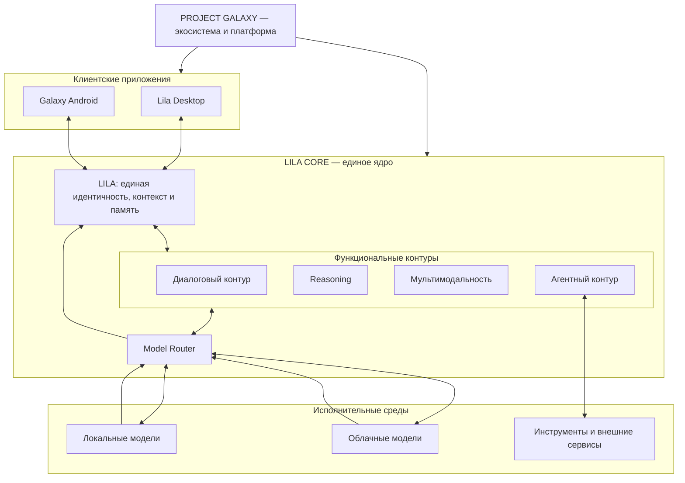

# Lila Core и Project Galaxy — архитектурная схема

> Ключевой принцип: **единая Лила, единая идентичность и общий контекст — несколько специализированных контуров и сменяемых моделей исполнения.** Локальная и облачная реализации являются разными способами предоставить возможности одной системы, а не отдельными персонами.

## 1. Уровни системы

### Project Galaxy — экосистема и платформа

Project Galaxy — верхний уровень проекта. Он объединяет приложения, инфраструктуру, интеграции, инструменты разработки и способы запуска Лилы.

В состав экосистемы входят:
- **Lila Core** — общее интеллектуальное и координационное ядро.
- **Lila Desktop** — настольная оболочка и рабочее пространство пользователя, подключающееся к Core.
- **Galaxy Android** — мобильное приложение и мобильный интерфейс доступа к возможностям Лилы.
- **Локальная и облачная инфраструктура** — вычислительные среды, модели, хранилища и внешние сервисы.

Galaxy — это платформа, в которой живёт и развивается Лила; Galaxy сам по себе не является ещё одной отдельной личностью.

### Lila Core — единое ядро Лилы

Lila Core отвечает за целостность системы: идентичность, контекст, память, выбор способа решения задач, координацию специализированных контуров и взаимодействие с инструментами.

Core не обязан быть одной конкретной языковой моделью или одним процессом. Он может использовать разные локальные и облачные модели, сохраняя общую идентичность и состояние.

## 2. Единая идентичность, контекст и память

Центральный слой **LILA** хранит и предоставляет всем контурам согласованную основу:
- идентичность и характер Лилы;
- пользовательские предпочтения и правила взаимодействия;
- историю диалога и рабочий контекст;
- долговременную память и знания;
- цели, активные проекты и состояние задач.

Все контуры обращаются к этому общему слою. Контекст не должен распадаться на независимые наборы воспоминаний для каждой модели или каждого клиентского приложения.

## 3. Функциональные контуры Lila Core

Контуры — специализированные функциональные подсистемы. Они могут работать совместно и передавать задачи друг другу.

### Диалоговый контур
Быстрые ответы, естественное общение, ведение диалога и поддержание conversational context.

### Reasoning — контур рассуждений
Глубокий анализ, планирование, сравнение вариантов, решение сложных задач и проверка выводов. Для таких задач Router может выбирать более сильную или специализированную модель.

### Мультимодальный контур
Работа с изображениями, видео и аудио: восприятие входных материалов, извлечение содержания и передача результатов в общий контекст. Генерация мультимодального контента подключается как соответствующая способность/инструмент.

### Агентный контур
Работа с инструментами и внешними системами, выполнение многошаговых задач, управление действиями, автоматизация и контроль результата. Действия выполняются с учётом разрешений и подтверждений пользователя там, где они необходимы.

## 4. Model Router

**Model Router** — слой выбора исполнителя для конкретной задачи.

Он получает задачу и доступный контекст, после чего выбирает подходящую модель или комбинацию моделей с учётом:
- типа задачи и требуемого качества рассуждений;
- мультимодальных возможностей;
- доступности локального или облачного исполнения;
- задержки, стоимости и вычислительных ограничений;
- приватности и требований к автономности.

Router может направить простую реплику в быструю локальную модель, сложный анализ — в более мощную модель, а мультимодальную задачу — в модель с нужной поддержкой входных данных. Результат возвращается в общий контекст Лилы.

Router выбирает **модель-исполнитель**, но не подменяет идентичность Лилы.

## 5. Исполнительные среды: локальные и облачные модели

### Локальные модели
- автономность и возможность работы без постоянного подключения к сети;
- приватность и локальная обработка данных;
- использование доступных ресурсов устройства или собственного сервера;
- резервный режим при недоступности облачных провайдеров.

### Облачные модели
- доступ к дополнительной вычислительной мощности;
- использование моделей, превосходящих локальные ресурсы по отдельным задачам;
- специализированные возможности и масштабирование.

Локальные и облачные модели — взаимодополняемые исполнители. Ни одна из них не должна становиться единственным носителем идентичности или памяти Лилы.

## 6. Клиентские приложения

Клиенты предоставляют пользователю интерфейс и доступ к возможностям Core:
- **Lila Desktop** — настольный интерфейс, рабочее пространство, управление подключениями и взаимодействие с локальной средой.
- **Galaxy Android** — мобильный интерфейс, голосовое и текстовое взаимодействие, мультимодальный ввод и доступ к функциям системы.

Клиенты не должны независимо определять личность Лилы или создавать несовместимые копии памяти. Они используют общий контракт Core и согласованные механизмы синхронизации контекста.

## 7. Поток обработки задачи

1. Пользователь обращается к Лиле через Desktop, Android или другой клиент.
2. Запрос и доступный контекст поступают в Lila Core.
3. Core определяет тип задачи и задействует нужные функциональные контуры.
4. Model Router выбирает подходящего локального или облачного исполнителя.
5. При необходимости агентный контур вызывает инструменты или внешние сервисы.
6. Результат проверяется, связывается с исходной задачей и возвращается в общий контекст и память по установленным правилам.
7. Клиент показывает ответ пользователю.

## 8. Схема связей

## 9. Архитектурные инварианты

1. **Одна Лила:** локальный и облачный режимы — формы исполнения одной системы, а не отдельные личности.
2. **Единая память и контекст:** приложения и модели используют согласованный общий слой состояния.
3. **Модели сменяемы:** замена провайдера или локальной модели не должна менять идентичность Лилы.
4. **Маршрутизация по задаче:** исполнитель выбирается исходя из требований задачи и доступных ресурсов.
5. **Модульность контуров:** диалог, reasoning, мультимодальность и агентные действия развиваются независимо, сохраняя общий контракт.
6. **Автономность:** локальный режим должен обеспечивать максимально полезную работу без обязательной зависимости от облака.
7. **Контролируемые действия:** инструменты и автоматизация работают через явные интерфейсы, с проверкой результата и необходимыми разрешениями.

## 10. Что эта схема определяет — и чего пока не определяет

Документ фиксирует концептуальную архитектуру и отношения между уровнями системы. Он **не** задаёт окончательные технологии, протоколы, API, схемы базы данных, формат памяти, конкретные модели или распределение процессов по устройствам. Эти решения должны оформляться отдельно в технических спецификациях и ADR, не нарушая перечисленные архитектурные инварианты.

## Агентный контур

Подробная спецификация владения задачами, планирования, инструментов, разрешений, исполнения, проверки, восстановления и поэтапной разработки находится в [Lila Agentic Runtime](LILA_AGENTIC_RUNTIME.md). Она расширяет эту архитектуру и не вводит второе ядро или отдельную память.
